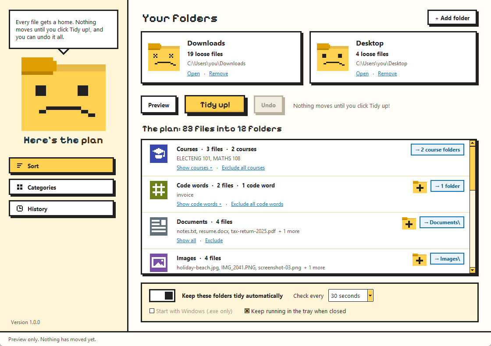
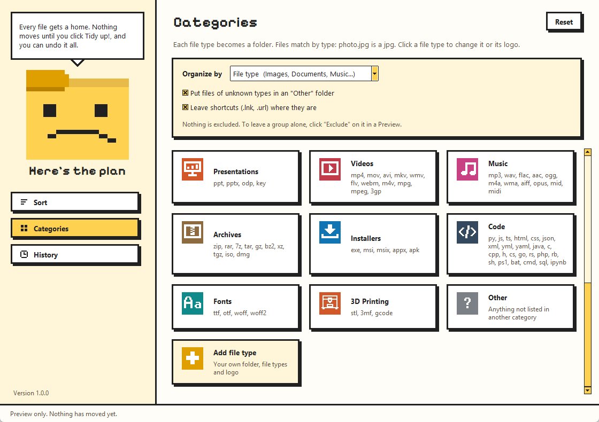
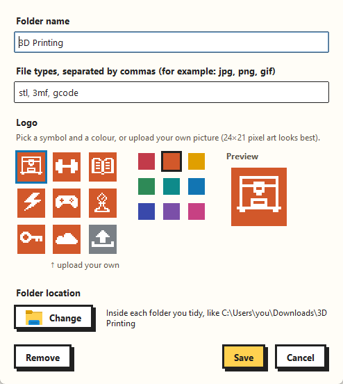

A small Windows app that tidies the loose files in your Downloads, Desktop or any other
folder into folders like **Images**, **Documents** and **Music**, with a pixel-art folder
buddy who gets happier the tidier things are.



- **Preview first:** see exactly what would move, and where, before anything moves.
- **Undo anything:** every tidy-up is listed on the History page and can be put back.
- **Your own file types:** add folders like 3D Printing for `.stl` files, each with its own logo.
- **Course folders and code words:** send `ELECTENG101 Lab 1.pdf` straight to your course
  folder, or anything with "invoice" in its name to `Documents\Finance`.
- **Automatic sorting** in the background, from the tray next to the clock.

## Download

1. Download **`Tidy Folders.exe`** from the
   [Releases page](https://github.com/UlyssesLuke/Tidy-Folders/releases). It's a single
   file; nothing else to install. Windows 10 or 11.
2. Put it anywhere you like (Desktop, `C:\Apps`...), then right-click it to
   **Pin to Start** or **Pin to taskbar**.
3. The first time you open it, Windows may say **"Windows protected your PC"**, because
   the app isn't code-signed. Click **More info**, then **Run anyway**.

## How to use it

1. **Add a folder:** click **Downloads**, **Desktop**, **Documents** or **Choose...**.
2. **Preview:** see every group of files and the folder it would go to.
   Click **Exclude** on anything you'd rather leave where it is.
3. **Tidy up!** The files move, and the buddy celebrates.
4. Changed your mind? **Undo** puts everything back, from the Sort page or the History page.

Only loose files move. Folders you already have, and everything inside them, are never touched.

## What it can do

### File types



The **Categories** page lists which file types go to which folder: `.jpg` to Images,
`.pdf` to Documents, and so on. Click a file type to change it, or click
**Add file type** (the last box) to make your own.



- **Logo:** pick one of 8 symbols and one of 9 colours, or upload your own picture
  (24×21 pixel art looks best; bigger pictures are shrunk to fit).
- **Folder location:** by default each folder you tidy gets its own, so `.stl` files in
  Downloads go to `Downloads\3D Printing` and ones on the Desktop go to `Desktop\3D Printing`.
  Click **Change** to keep them all in one place instead, like `Documents\3D Printing`.
  **Use the usual place** puts it back. Clicking the **Other** card does the same for files
  of unknown types.
- **Organize by:** file type (`Images\photo.jpg`), file type and month
  (`Images\2026-11\photo.jpg`), or month only (`2026-11\photo.jpg`).

### Course folders and code words

On the Categories page, under **Send files by name**:

- **Course folders:** pick the folder that holds your course folders. They're found
  anywhere inside it, including inside year and semester folders. A course folder's name
  starts with a course code (letters, then 3 or 4 digits, like `ELECTENG 101`). Any file
  whose name contains that code goes into it: `ELECTENG101_Lab1.pdf`,
  `electeng 101 notes.docx` and `ElectEng_101.zip` all go to `ELECTENG 101`. If the same
  course is in more than one place, the newest year or semester is used.
- **Code words:** a word and a folder, like `invoice` → `Documents\Finance`.

Capitals, spaces, dashes and underscores don't matter. The code has to start a "word" in
the file name: `bombo electeng101.txt` counts for ELECTENG 101, `bomboelecteng101.txt` doesn't.

**Which wins?** Course folders first, then code words (in the order you added them), then
the file type. So `invoice ELECTENG101.pdf` goes to the course folder.

In the Preview, all courses share one **Courses** row and all code words one
**Code words** row. **Show ▾** lists each one, and **Exclude all** / **Include all** act on
all of them at once, including ones you add later.

### New folders

A folder like `Installers` is only made when a file needs it. In the Preview, a small
**folder with a +** means that folder doesn't exist yet and Tidy up! will make it. Hover
it to see where; **click it to choose a different place**. Hover the blue **→ Folder\\**
label to see the full path. Undo removes folders a tidy-up made, once they're empty again.

### Automatic sorting and the tray

- Switch on **Keep these folders tidy automatically**, then click **Tidy up!** once:
  nothing moves until you do, so the first tidy-up is always yours to check. After that,
  new files are sorted by themselves. Files are left alone until they're a minute old,
  so downloads can finish.
- **Closing the window** hides it to the tray (next to the clock; on Windows 11 it may be
  under the **^** arrow). Click the tray icon to open it again; right-click for
  *Sort now*, *Automatic sorting* and *Quit*.
- **Start with Windows** (bottom of the Sort page) opens it quietly in the tray when you
  sign in. If you move the .exe, open it once from its new place and this follows it.

## What it never does

- It never deletes or overwrites anything. If a name is taken, the file becomes `photo (2).jpg`.
- It never touches folders you already have, or anything inside them.
- It leaves alone: hidden and system files, shortcuts (you can change this), Office's
  temporary `~$` files, downloads that haven't finished (`.crdownload`, `.part`), and for
  automatic sorting, files less than a minute old.
- It won't sort a whole drive, your whole user folder, Windows, Program Files or AppData.
- It doesn't use the internet.

## Settings, uninstalling, and if something goes wrong

Your settings, undo history and uploaded logos are kept in `%APPDATA%\TidyFolders`
(paste that into File Explorer's address bar to open it).

**To uninstall:** switch off **Start with Windows** (or turn it off in Windows Settings >
Apps > Startup), quit from the tray, and delete `Tidy Folders.exe`. To remove your
settings too, delete the `%APPDATA%\TidyFolders` folder. Files that were already sorted
stay where they are.

**If something goes wrong,** the app saves the details to `error.log` in that same folder
and tells you. Please [open an issue](https://github.com/UlyssesLuke/Tidy-Folders/issues)
with that file and what you were doing. The version number is at the bottom left of the window.

## Credits and license

Made by [UlyssesLuke](https://github.com/UlyssesLuke).

- **The code** is free to use, change and share under the [MIT License](LICENSE).
- **The art is not.** The pixel art (the folder buddy, icons, logo symbols, animation and
  so on, in `tidy_folders/assets`) and the screenshots in `docs/screenshots` are
  © UlyssesLuke, all rights reserved. You can keep it in forks of this repository and use
  it when you run or build Tidy Folders for yourself, but not in other projects, and not in
  a version of the app you share. Replace it with your own art first. Details are in
  [tidy_folders/assets/LICENSE.txt](tidy_folders/assets/LICENSE.txt).
- Headings use [Pixelify Sans](https://fonts.google.com/specimen/Pixelify+Sans), under its
  own license (SIL Open Font License, see `tidy_folders/assets/fonts/OFL.txt`).

---

## For developers

### Run from source

Python 3.11+ on Windows. Double-click `Tidy Folders.pyw`, or run `python -m tidy_folders`.
The tray icon needs `pip install -r requirements.txt`; start with Windows only works in the .exe.

### Build the .exe

Double-click **`build.bat`**. The first run sets up the build tools in `.venv`
(PyInstaller, Pillow); later runs take about a minute. Output: `dist\Tidy Folders.exe`.
Ship it as a file on a GitHub Release, not in the repository (`dist/` is ignored).

The version is in `tidy_folders/__init__.py` (shown in the app and in `error.log`) and in
`packaging/version_info.txt` (the .exe's Properties > Details): change both together. The
icon is drawn by `packaging/make_icon.py` from `assets/logo/24.png`.

### Tests

```
python -m unittest discover tests
```

The sorting rules, settings, start-up and error log (no windows open).

```
python tests\gui\run_all.py
```

Click-through checks of the real window (about 3 minutes): the Preview, courses, code
words, folder locations, the logo picker, the smallest window size, the animation, errors
and a full walk through the app. Windows open and close by themselves, so leave the mouse
alone while it runs. Each check uses its own temporary folders and settings, never yours.
Screenshots are saved in `tests\gui\shots`. Run some of them with a name, like
`python tests\gui\run_all.py courses`.

After building, `powershell -ExecutionPolicy Bypass -File tests\gui\check_exe_tray.ps1`
checks the .exe itself: starting in the tray, auto-sorting while hidden, and only one copy running.

`python packaging\readme_screenshots.py` retakes the screenshots in this README.

### Art

All the pixel art is in `tidy_folders/assets/` (all rights reserved, see `LICENSE.txt` there;
if you share your own version of the app, swap in your own art). To change a piece, replace
its PNG with one the same size and rebuild. The app scales art up by whole numbers, so pixels stay crisp.

| Folder | What it is |
| --- | --- |
| `faces/` | The folder buddy: happy, happy_tongue, sad, dead, smug, surprised, front (24×21). `front` is the plain face, also used for file types without a logo |
| `categories/` | One icon per file type, named after it, e.g. `Images.png`, plus `Course.png` and `Code word.png` for the Courses and Code words rows (24×21) |
| `glyphs/` | Logo symbols `1.png`-`8.png` (16×14, white on transparent; the app puts them on a coloured tile), `upload.png` for "upload your own" and `add.png` for the Add file type box |
| `badges/` | `new_folder.png`: the folder with a + in the Preview (16×14) |
| `sorting/` | The sorting animation: `Sorting_1.png`, `Sorting_2.png`... (24×21, any number of frames) and `timings.txt` (milliseconds per frame) |
| `nav/` | Sidebar icons (16×16) |
| `button/` | The Tidy up! button: normal, hover, pressed (48×16) |
| `switch/` | The automatic sorting switch: on, off (20×10) |
| `sparkle/` | Celebration sparkles 1-3 (8×8) |
| `logo/` | The app logo, `24.png`; `build.bat` makes `icon.ico` from it |
| `tray/` | Tray icons (16×16 and 32×32) |
| `fonts/` | Pixelify Sans Bold (SIL Open Font License, `OFL.txt`) |
